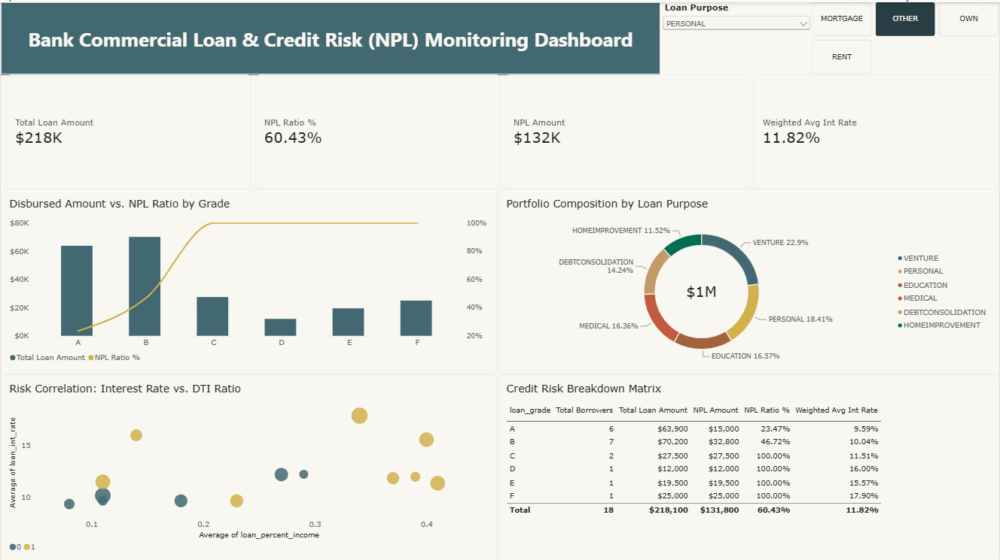

# Commercial Bank Credit Risk & NPL Monitoring Dashboard

[](https://powerbi.microsoft.com/)
[](https://learn.microsoft.com/en-us/dax/)
[](#)

An interactive, executive-grade Business Intelligence dashboard developed in **Power BI** to monitor credit risk exposure, evaluate portfolio health, and uncover default drivers across a **$312.43M** commercial loan portfolio.

---

## Dashboard Preview




---

## Business Problem & Context

In the banking and credit industry, unmonitored **Non-Performing Loans (NPL)** severely impact capital adequacy, net interest margins, and operational profitability. 

Risk management and credit underwriting teams require a unified analytical tool to:
1. Track the macro portfolio health and total capital at risk (**$68.12M** default exposure).
2. Segment high-risk debtor groups across credit grades (**A–G**), loan purposes, and demographic profiles.
3. Establish data-backed debt-to-income (**DTI**) and interest rate thresholds to minimize future loan default rates.

---

## Key Portfolio Metrics (KPIs)

* **Total Disbursed Volume:** $312.43M
* **Overall NPL Ratio (%):** 21.82%
* **Total Non-Performing Exposure:** $68.12M
* **Weighted Average Interest Rate:** 11.01%
* **Total Portfolio Borrowers:** 32,581 debtors

---

## Key Insights & Analytical Findings

1. **Severe Risk Inversion in Subprime Grades (D – G):**
   * While Grades **A** and **B** represent **~63%** of total disbursed capital with relatively controlled NPL rates (11% and 18% respectively), Grades **D to G** exhibit alarming default rates ranging from **58% to over 99%**.
2. **Vulnerability in Tenant Demographics (Status: RENT):**
   * Borrowers who rent their homes show a significantly higher default risk compared to mortgage and home-owning segments. In emergency loans (e.g., *Medical* for *Renters*), the NPL ratio climbs to **41.3%**.
3. **Debt-to-Income (DTI) Default Threshold:**
   * Correlation analysis confirms that when a borrower's `loan_percent_income` (DTI) exceeds **0.25 (25%)**, default density increases substantially. Borrowers with DTI > **0.35** paired with interest rates above **14%** demonstrate a default probability exceeding 85%.

---

## Data Pipeline & DAX Architecture

All core business calculations are centralized within an isolated `_Measures` table using optimized DAX expressions:

```dax
// 1. Total Disbursed Loan Volume
Total Loan Amount = SUM(credit_risk_dataset[loan_amnt])

// 2. Total Non-Performing Loan Exposure
NPL Amount = 
CALCULATE(
    SUM(credit_risk_dataset[loan_amnt]),
    credit_risk_dataset[loan_status] = 1
)

// 3. Gross NPL Ratio (%)
NPL Ratio % = 
DIVIDE([NPL Amount], [Total Loan Amount], 0)

// 4. Weighted Average Portfolio Interest Rate
Weighted Avg Int Rate = 
DIVIDE(
    SUMX(credit_risk_dataset, credit_risk_dataset[loan_amnt] * (credit_risk_dataset[loan_int_rate] / 100)),
    [Total Loan Amount],
    0
)

// 5. Total Borrowers Count
Total Borrowers = COUNTROWS(credit_risk_dataset)

Strategic Recommendations
Underwriting Policy Revision: Immediately cap or require full collateral backing for unsecured credit applications classified under Grades E, F, and G.

DTI Hard Limits: Implement a maximum allowable DTI threshold of 30% for applicants under the RENT home ownership status.

Proactive Collections & Restructuring: Focus early warning collection workflows on Debt Consolidation and Medical loan facilities showing NPL rates above 26%.

How to Run the Project
Clone this repository:

Bash
git clone [https://github.com/your-username/credit-risk-powerbi-dashboard.git](https://github.com/your-username/credit-risk-powerbi-dashboard.git)
Download and install Power BI Desktop.

Open the file credit_risk_monitoring.pbix.

If prompted, refresh the dataset connection pointing to data/credit_risk_dataset.csv.

Repository Structure
Plaintext
├── data/
│   └── credit_risk_dataset.csv      # Raw source dataset
├── assets/
│   └── dashboard_overview.png       # Dashboard screenshot preview
├── credit_risk_monitoring.pbix      # Power BI project file
└── README.md                        # Project documentation